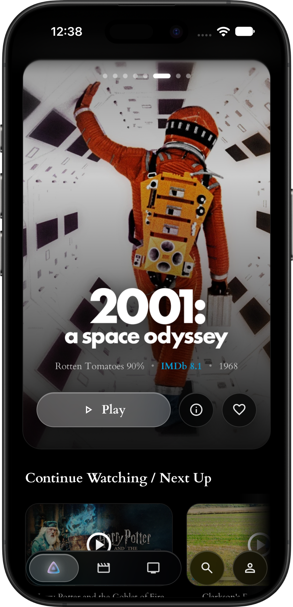
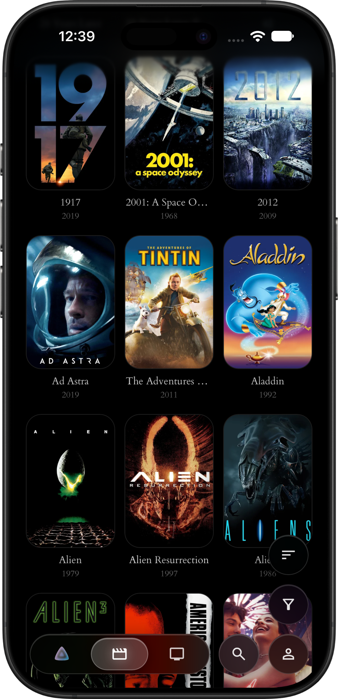
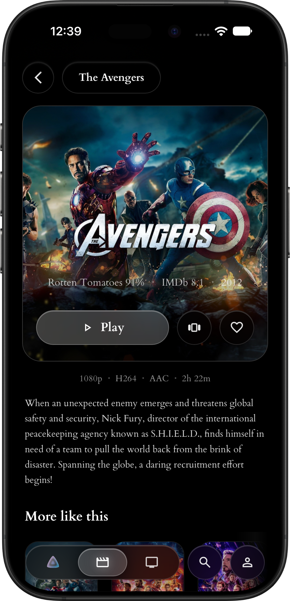
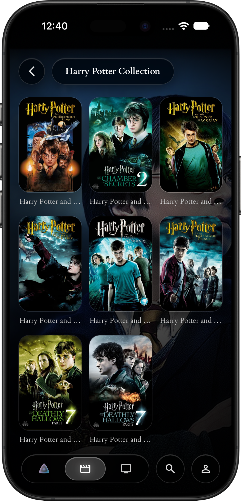
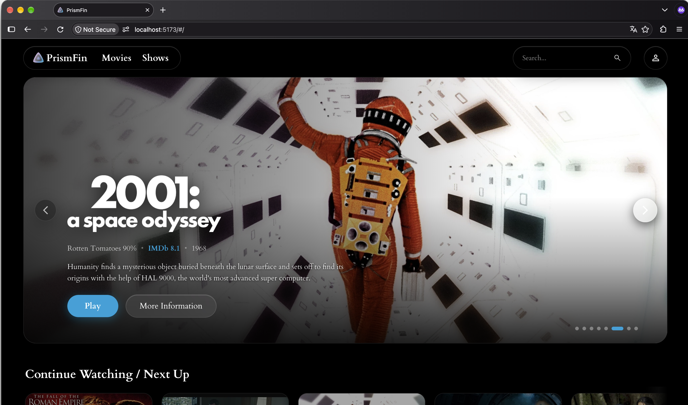
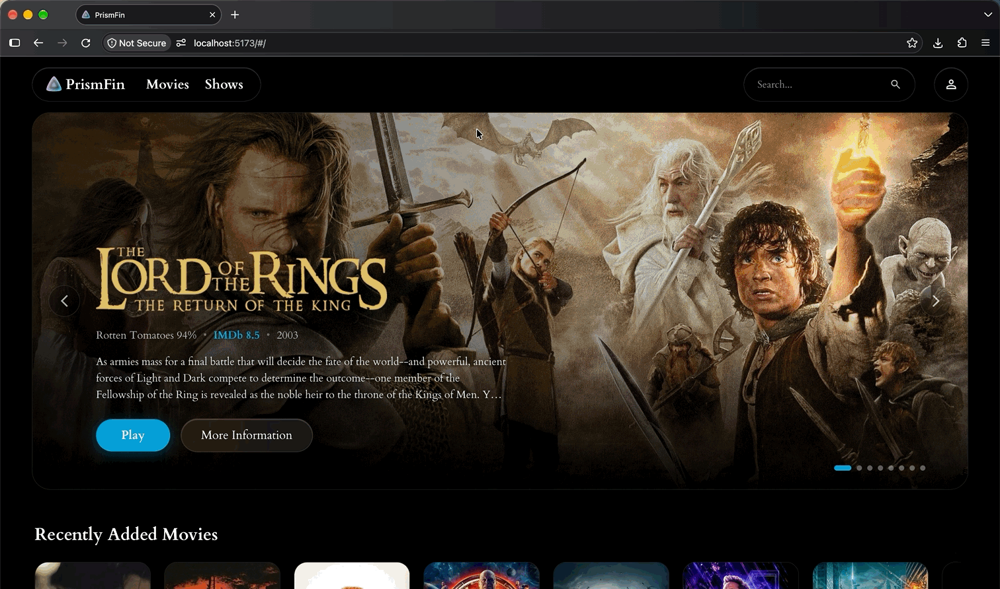

**Prismfin is a whitelabel Jellyfin web client based on Apple's Liquid Glass design language. It offers a full desktop- and a Progressive Web App (PWA) mobile experience.**

## 📸 Screenshots

<p align="center">
  
  
  
  
</p>

<p align="center">
  
  
</p>

## ✨ Features
- **🎨 Customizable branding**, Prismfin is a whitelabel solution, offering you to change the title, logo, icon and accent color via environment variables. This even extends to the PWA icon, making a custom mobile client possible.

- **🖋️ Custom subtitle styling**, Easy to customize subtitles for web. No need for embedded subtitles on mobile. The subtitle tracks are shared with the native player on Android and iOS.

- **🏠 Home Screen Sections (HSS) Support**, Prismfin natively supports the HSS plugin automatically and saturates the home screen if installed.

- **📜 Customizable 'Featured' Hero Content**, Prismfin populates the hero slides automatically using your own playlist via an environment variable.

- **🏞️ Trickplay Support**, Native Jellyfin trickplay scrubbing is supported in the web client, making it easy to find the right spot when watching content.

- **🔑 SSO/OIDC Support via the SSO-Auth plugin for Jellyfin**, If you already have the SSO-Auth plugin configured on your Jellyfin instance, Prismfin automatically shows your custom login options. 

## 🚀 Installation

<details open>
<summary><b>1. Docker compose (recommended)</b></summary>
Create a `docker-compose.yml` file:

```yml
services:
  prismfin:
    image: ghcr.io/JortWillemsen/prismfin:main
    container_name: prismfin
    restart: unless-stopped
    ports:
      - "8080:80"
    environment:
      # Application branding & title
      - APP_NAME=Prismfin
      - APP_ACCENT_COLOR=#06A1DB
      - FEATURED_PLAYLIST_NAME=Featured

      # Jellyfin Server Configuration
      - DEFAULT_SERVER_URL=https://jellyfin.example.com
      # Optional: Internal backend address used by Nginx for SSO and proxying. Essential for SSO/OIDC to work.
      - JELLYFIN_INTERNAL_URL=http://192.168.x.x:30013

      # Optional: Custom branding assets (Web URLs or paths relative to the web root)
      - APP_LOGO_URL=/assets/branding/logo.png
      - APP_ICON_URL=/assets/branding/icon.png
      - APP_FAVICON_URL=/assets/branding/favicon.png
    # Optional: Mount your own branding directory
    volumes:
      - ./my-branding:/usr/share/nginx/html/assets/branding:ro
```

Run the container:

```bash
docker compose up -d
```
---
</details>

<details closed>
<summary><b>2. Docker run</b></summary>

```bash
docker run -d \
  --name prismfin \
  --restart unless-stopped \
  -p 8080:80 \
  -e APP_NAME="Prismfin" \
  -e DEFAULT_SERVER_URL="https://jellyfin.example.com" \
  -e JELLYFIN_INTERNAL_URL="http://jellyfin.local:8096" \
  -e APP_ACCENT_COLOR="#06A1DB" \
  ghcr.io/your-username/prismfin:latest
```
---
</details>

<details closed>
<summary><b>3. Local development (Building from source)</b></summary>

Prismfin is built with [Deno](https://deno.land/) and React 18 / Vite.

#### Prerequisites
- [Deno](https://deno.land/#installation) (v1.40 or higher)

#### Setup & Run
1. **Clone the repository:**
   ```bash
   git clone https://github.com/JortWillemsen/prismfin.git
   cd prismfin
   ```

2. **Configure environment variables:**
   ```bash
   cp .env.example .env.development
   ```
   Edit `.env.development` to point `VITE_JELLYFIN_SERVER_URL` to your Jellyfin instance.

3. **Install dependencies & start dev server:**
   ```bash
   deno install
   deno task dev
   ```
   The application will be available at `https://localhost:5173`.

4. **Production Build:**
   ```bash
   deno task build
   ```

---
</details>

<details closed>
<summary><b>Extra: Installing the PWA on Mobile</b></summary>

Prismfin is a full Progressive Web App that can be installed directly to your phone's home screen with standalone display and native look-and-feel:

- **iOS (Safari)**: Open your Prismfin URL in Safari, tap the **Share** button, and select **"Add to Home Screen"**.
- **Android (Chrome / Edge)**: Open your Prismfin URL in Chrome, tap the menu (⋮) in the top-right corner, and select **"Install App"** (or tap the install prompt banner).
</details>

## 🙏 Contributing
You are free to contribute to Prismfin. Start by forking this repositoy and building your dream feature. When ready, you can submit a pull request for review. If your pull request consists of major changes, contacting me by opening an issue helps align your work to the goals and direction of the project.

*Note: Prismfin is a hobby project and support for the project can only be done during my free time. Please be patient!* 

## License
Prismfin is licensed uner the GNU General Public License Version 3.0 (GPLv3).

A full lisence description can be found in `/LICENSE`

## ⚠️ Disclaimers
### Piracy
Prismfin and its authors do not support or condone piracy of any kind. This software is created and intended as an alternative frontend for streaming your legally owned media from your own Jellyfin server. Any reference to tools, methods and websites related to piracy are strictly prohibited.

### AI usage
This project uses LLM assisted development using Gemini 3.8 Flash. All code is checked and verified by a human. The use of LLM assisted contributions are welcome, but need to adhere to software development standards.

### Security
This project and it's authors are not liable for any security issues or information leaks as a result of using this software. This software does not collect or share your information with any third parties that you do not explicitly enable yourself (Jellyfin Server, SSO/OIDC provider). 
